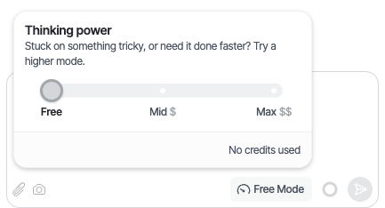
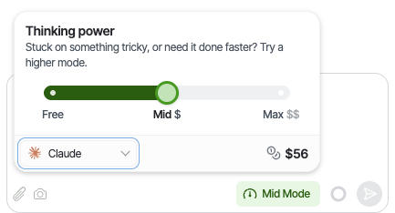

The side navigation runs down the left edge of the editor and is always visible. Its contents change depending on which view you're currently in — it shows only the tools relevant to what you're working on.

---

## Canvas mode

When working on a page in the Canvas, the side navigation contains three sections:

**AI Chat** — the Scram AI assistant. Ask it to build components, explain concepts, or help you work through a problem. Available in all views.

**Page Structure** — a tree view of every component on the current page, showing the hierarchy of containers and elements. Use it to select, reorder, and navigate between components — particularly useful on complex pages where clicking on the canvas is difficult.

**Component Instance Editor** — appears when a component is selected on the canvas. It configures _this particular instance_ of the component, not the component definition itself. Contains three tabs:

- **Properties** — set the values of the component's props for this instance, including Content, Appearance, Attributes, and any Exposed Variables.
- **Styles** — control the visual styling of this instance — colours, spacing, typography, and layout.
- **Logic** — attach workflows to the events this component emits, such as what happens when it is clicked or when its value changes.

To edit the underlying component definition itself, see [The Component Editor](/understanding/subpages/the-component-editor)

---

## Workflow Editor mode

When working in the Workflow Editor, the side navigation contains:

**AI Chat** — the Scram AI assistant, as above.

**Workflow Config** — configuration options for the current workflow, including its trigger, settings, and metadata.

---

## More mode

When working in the More View, the side navigation contains:

**AI Chat** — the Scram AI assistant, as above. The Resource View tools are accessed directly within the main area rather than through the side navigation.

---

## Choosing the AI model

The mode button in the chat message box shows your current mode, for example **Free Mode**. Click it to open **Thinking power**, then pick a mode on the slider:

| Mode | Use it for |
| --- | --- |
| **Free** | The default. Slower, but handles most builds. |
| **Mid (\$)** | Faster reasoning for multi-step features. |
| **Max (\$\$)** | Deepest reasoning for hard bugs and refactors. |

Free uses no credits. Mid and Max use credits, and Max uses more. Your credit balance shows at the bottom of the menu.

For **Mid** and **Max**, you can also choose the model family, **Claude** or **ChatGPT**, at the bottom of the menu. Scram remembers your choice in this browser.

<Note>
  If your project has used up its Free mode allowance, the first stop reads **Basic (\$)** instead. It's the same model, charged to your credits until Free mode is available again.
</Note>
